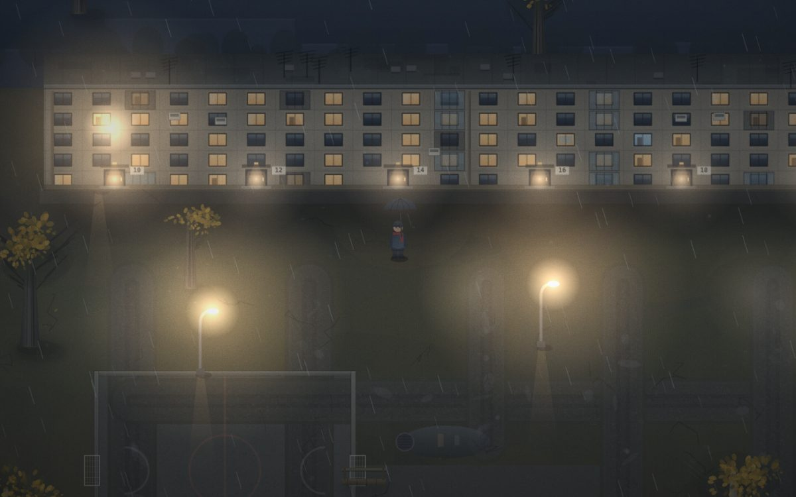
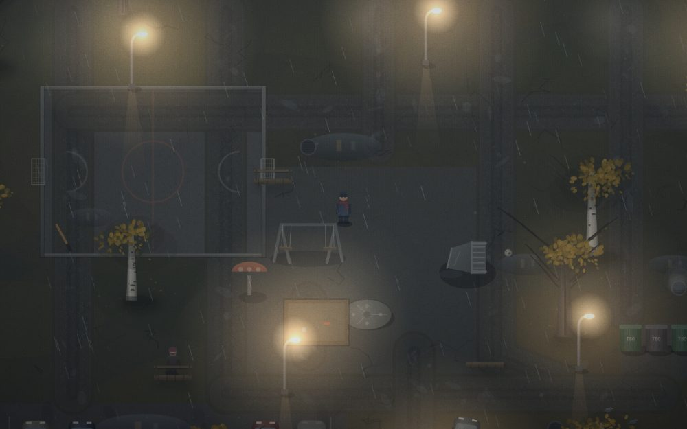
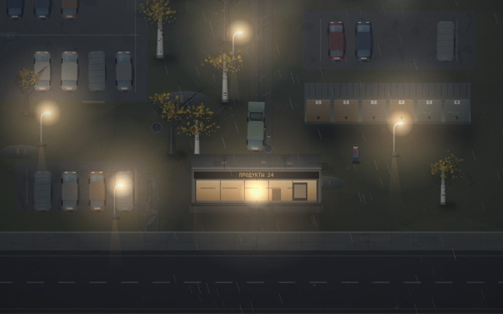

# ТОСКА — дворы

Маленькая 2D-прогулка по русскому двору. Поздняя осень, 19:47, дождь. Пятиэтажка, парковка с «Ладой», хоккейная коробка, качели, гаражи, кот и бабушка на лавочке.





Всё нарисовано кодом на canvas — спрайтов нет. Звук (дождь, ветер, шаги, скрип качелей, урчание кота, далёкий гудок) тоже генерируется процедурно через Web Audio.

## Как запустить

```bash
npm install
npm run dev
```

Открыть `http://localhost:5173`.

Сборка: `npm run build` → `dist/`.

## Управление

| Клавиша | Действие |
|---|---|
| `WASD` / стрелки | идти |
| `Shift` | бежать |
| `E` | взаимодействовать / дальше / встать |
| `Q` | зонт |
| `F` | фонарик |
| `M` | звук вкл/выкл |
| `Esc` | закрыть мысль |

На телефоне — джойстик слева, кнопки `E` и `☂` справа.

## Что можно потрогать

Лавочки (сесть), качели (покачаться), карусель, песочница, контейнеры, трансформаторная будка с «ЦОЙ ЖИВ», хоккейная коробка, мяч, кот (пойдёт за тобой), голуби (взлетят), автобусная остановка, радио на подоконнике, домофон, «Продукты 24», гаражи, дорога, бабушка Зинаида Петровна и Серёга с «Ладой».

Мысли появляются сами: при входе в новые места, после долгой прогулки и при взаимодействии.

## Файлы

```
index.html          разметка, титульный экран, HUD, тач-кнопки
public/house.jpg    изображение дома (титульный экран)
src/world.js        мир: дома, двор, парковки, деревья, объекты, коллизии, тексты
src/render.js       отрисовка: земля, дома, машины, деревья, мелочи
src/player.js       персонаж: ходьба, пальто, шапка, зонт, дыхание
src/fx.js           дождь, свет, туман, зерно, виньетка
src/audio.js        процедурный звук
src/main.js         цикл, камера, ввод, взаимодействия
tools/smoke.mjs     прогон движка в Node с заглушкой canvas (ищет ошибки)
```

## Мелочи, которые стоит заметить

- Часы идут: одна игровая минута ≈ 11 секунд.
- Свет в окнах разный: тёплый, холодный, где-то мерцает телевизор.
- На дороге изредка проезжают машины, слышно, как они приближаются и уходят.
- Из люка идёт пар, у Серёги дымит сигарета, на холоде видно дыхание.
- В лужах отражается свет и персонаж.
- `node tools/smoke.mjs` — быстрый прогон на ошибки без браузера (заглушка canvas).
- `npm i --no-save @napi-rs/canvas && node tools/shot.mjs` — реальные скриншоты игры в `/tmp/shots` без браузера.
